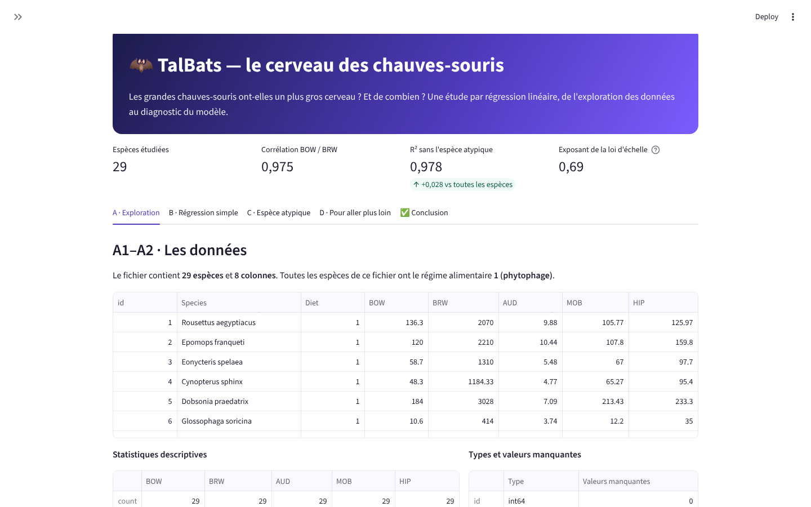
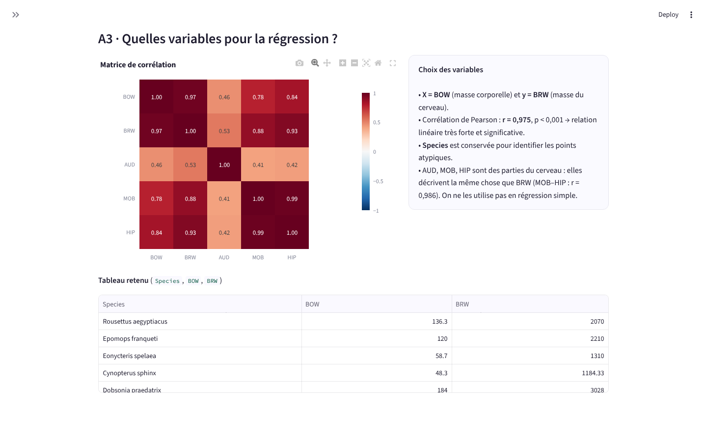
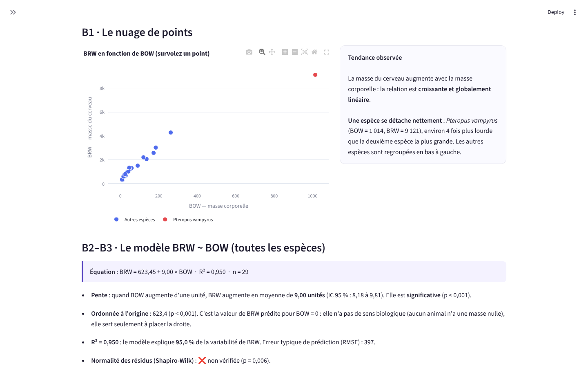
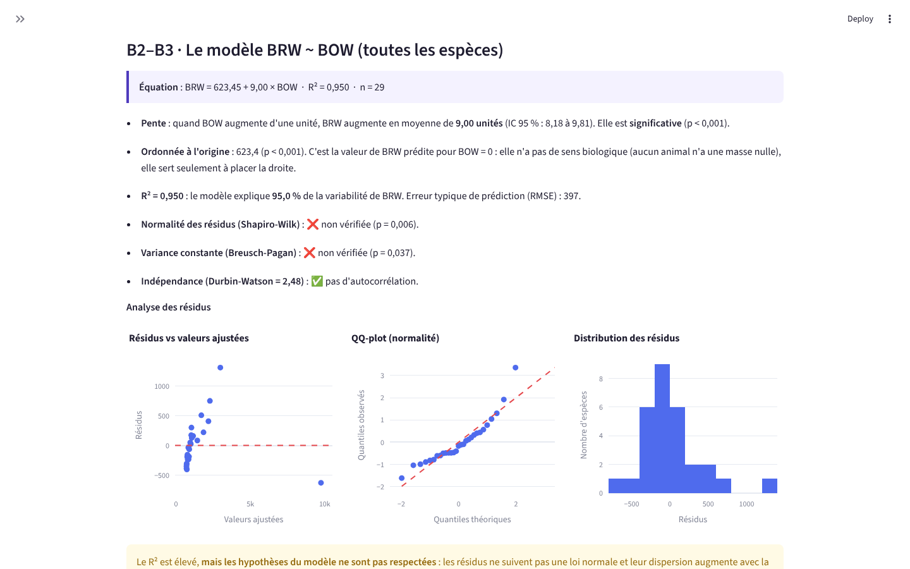
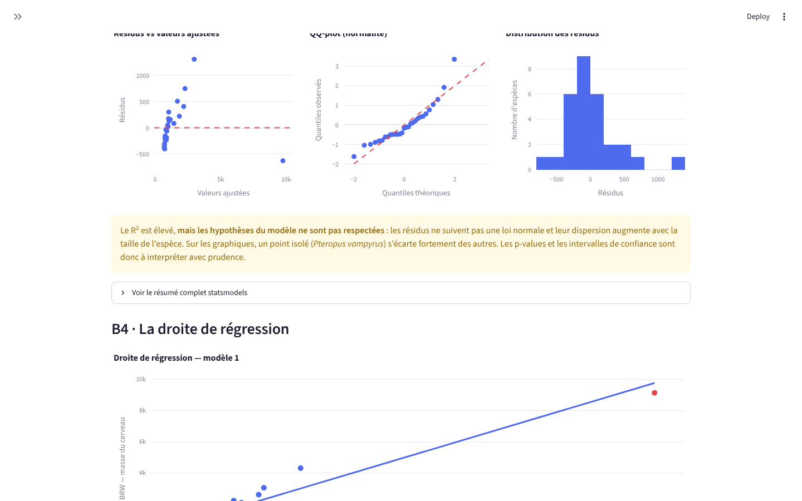
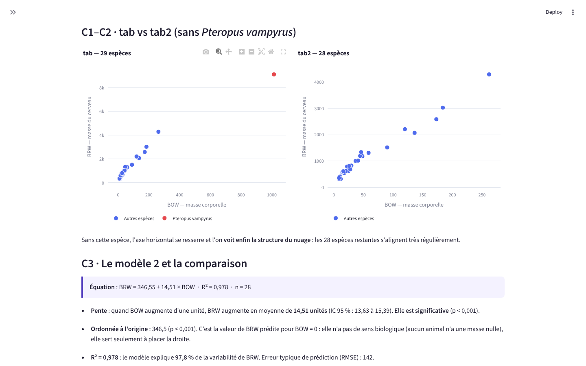
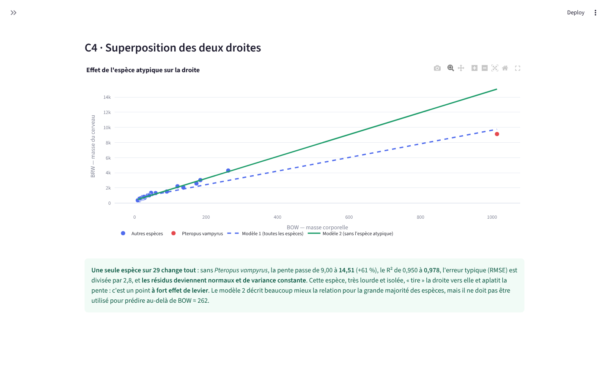
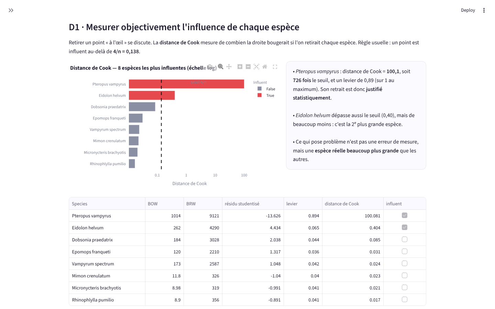
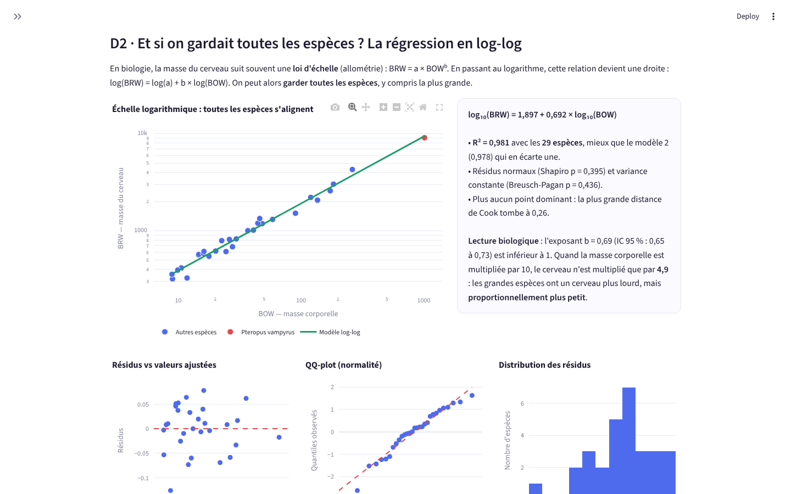
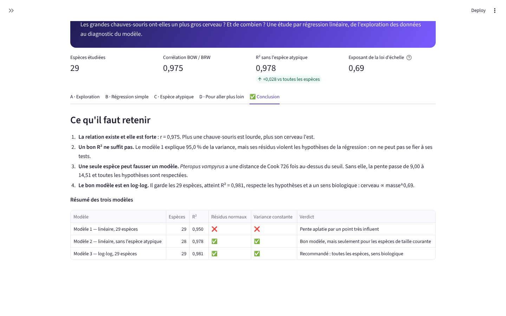

<div align="center">

# 🦇 TalBats

**Les grandes chauves-souris ont-elles un plus gros cerveau ? Et de combien ?**

Une étude par régression linéaire, de l'exploration des données au diagnostic du modèle,
présentée dans une application Streamlit interactive.




</div>

---

## 📌 Sommaire
- [Le projet](#-le-projet)
- [Résultats en un coup d'œil](#-résultats-en-un-coup-dœil)
- [L'analyse, étape par étape](#-lanalyse-étape-par-étape)
- [Lancer l'application](#-lancer-lapplication)
- [Organisation du code](#-organisation-du-code)

---

## 🎯 Le projet

Projet réalisé dans le cadre du cours **Machine Learning I** (TP 2 — Régression).

Le jeu de données décrit **29 espèces de chauves-souris** :

| Variable | Signification |
|---|---|
| `Species` | Nom de l'espèce |
| `Diet` | Régime alimentaire (ici, toutes les espèces sont phytophages) |
| `BOW` | *Body weight* — masse corporelle |
| `BRW` | *Brain weight* — masse du cerveau |
| `AUD`, `MOB`, `HIP` | Volumes de différentes structures du cerveau |

**Question** : peut-on expliquer la masse du cerveau (BRW) par la masse corporelle (BOW) avec une régression linéaire simple,
et que se passe-t-il quand une espèce est très différente des autres ?

---

## 📊 Résultats en un coup d'œil

| Modèle | Espèces | Équation | R² | Résidus normaux | Variance constante |
|---|:-:|---|:-:|:-:|:-:|
| **1** · linéaire, toutes les espèces | 29 | BRW = 623,4 + 9,00 × BOW | 0,950 | ❌ | ❌ |
| **2** · linéaire, sans *Pteropus vampyrus* | 28 | BRW = 346,5 + 14,51 × BOW | 0,978 | ✅ | ✅ |
| **3** · log-log, toutes les espèces | 29 | log BRW = 1,897 + 0,692 × log BOW | **0,981** | ✅ | ✅ |

**Les 4 enseignements :**
1. **La relation est très forte** : corrélation de Pearson r = 0,975 (p < 0,001).
2. **Un bon R² ne suffit pas** : le modèle 1 explique 95 % de la variance, mais ses résidus violent les hypothèses de la régression.
3. **Une seule espèce fausse le modèle** : *Pteropus vampyrus* (la plus grande, environ 4 fois plus lourde que la suivante) a une distance de Cook **726 fois** au-dessus du seuil. Sans elle, la pente passe de 9,00 à 14,51 (+61 %).
4. **Le meilleur modèle est en log-log** : il garde toutes les espèces et a un sens biologique.
   Le cerveau suit une **loi d'échelle** BRW ∝ BOW^0,69 : quand la masse corporelle est multipliée par 10, le cerveau n'est multiplié que par 4,9.
   Les grandes espèces ont un cerveau plus lourd, mais **proportionnellement plus petit**.

---

## 🔬 L'analyse, étape par étape

L'application suit les parties du TP, puis va plus loin.

### Partie A — Exploration
Aperçu des données, types, statistiques descriptives, valeurs manquantes, matrice de corrélation et choix des variables.
AUD, MOB et HIP sont des parties du cerveau : elles décrivent la même chose que BRW, on ne les utilise donc pas pour expliquer BRW.



### Partie B — Première régression linéaire simple
Le nuage de points montre une relation croissante, et **une espèce isolée** (en rouge, survolez un point pour voir son nom).

| Nuage de points | Modèle 1 et commentaires |
|---|---|
|  |  |

Les commentaires (pente, significativité, R², hypothèses) sont **générés automatiquement à partir des résultats**.
Le diagnostic des résidus (résidus vs valeurs ajustées, QQ-plot, histogramme, tests de Shapiro-Wilk, Breusch-Pagan et Durbin-Watson) montre que le modèle 1 ne respecte pas les hypothèses :



### Partie C — Retrait de l'espèce atypique
Création de `tab2` sans *Pteropus vampyrus*, comparaison des nuages, second modèle, tableau comparatif et superposition des deux droites.

| tab vs tab2 | Les deux droites |
|---|---|
|  |  |

### Partie D — Pour aller plus loin
- **Distance de Cook** : une mesure objective de l'influence de chaque espèce, pour justifier statistiquement le retrait plutôt que de le faire « à l'œil ».
- **Régression log-log** : un modèle qui garde toutes les espèces et respecte les hypothèses.
- **Simulateur** : choisissez une masse corporelle et comparez les prédictions des trois modèles.

| Influence de chaque espèce | Loi d'échelle (log-log) |
|---|---|
|  |  |

### Conclusion


---

## 🚀 Lancer l'application

**Prérequis** : Python 3.10 ou plus récent.

**Windows, en un double-clic** : `lancer.bat` (il installe tout la première fois, puis ouvre l'application).

**À la main :**
```bash
python -m venv .venv
# Windows : .venv\Scripts\activate     macOS / Linux : source .venv/bin/activate
pip install -r requirements.txt
streamlit run app.py
```
L'application s'ouvre sur http://localhost:8501 et charge directement `data/tabBats.txt`.
On peut aussi importer un autre fichier au même format depuis la barre latérale.

**Lancer les tests :**
```bash
pytest -v
```

---

## 🗂️ Organisation du code

```
talbats/
├── app.py                       Application Streamlit (affichage uniquement)
├── src/
│   └── analysis.py              Tous les calculs : chargement, régressions, tests, influence, commentaires
├── data/
│   └── tabBats.txt              Les données (29 espèces)
├── notebooks/
│   └── analyse_exploratoire.ipynb   Première version de l'analyse, en notebook
├── tests/
│   └── test_analysis.py         9 tests des calculs (pytest)
├── docs/screenshots/            Captures utilisées dans ce README
├── .github/workflows/tests.yml  Les tests sont relancés automatiquement à chaque push
├── .streamlit/config.toml       Thème de l'application
├── requirements.txt
└── lancer.bat
```

**Choix de conception** : les calculs (`src/analysis.py`) sont séparés de l'affichage (`app.py`).
Ils peuvent ainsi être testés automatiquement et réutilisés dans un notebook ou un autre outil.

---

## 👤 Auteur

**Elie Samson Kombiwo** — Data Scientist (MLOps / LLMOps)
[GitHub](https://github.com/gitsam1path) · [LinkedIn](https://www.linkedin.com/in/elie-samson-kombiwo-4075a4284)
